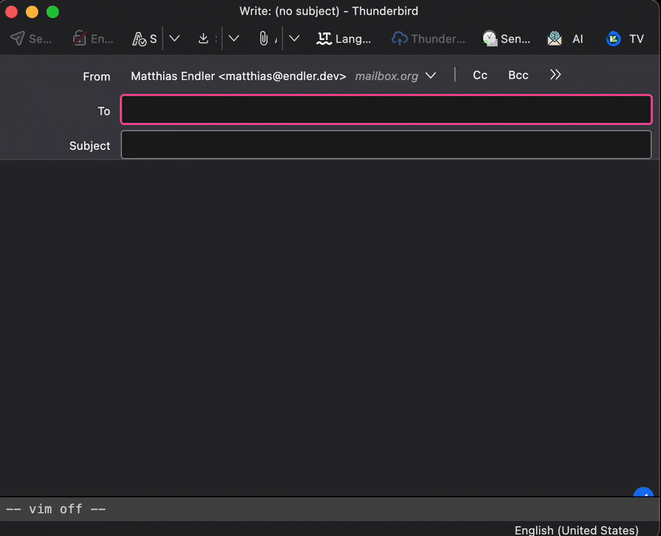

# Thundervim

Vim keybindings for editing email in Thunderbird's compose window.

Write email the way you edit code: Normal / Insert / Visual modes, motions,
operators, text objects, search, and paragraph reflow, all inside the
Thunderbird composer, with a vim-style status line and block cursor to match. It
works in both plain-text and rich-text (HTML) compose windows. In HTML, your
existing formatting (quoted replies, signatures, bold, links) stays intact while
you edit the text.

## Requirements

- **Thunderbird 151 or newer** (developed and tested against 152).
- Works in both plain-text and HTML compose windows. Plain text is the most
  battle-tested; HTML support keeps your formatting but is newer (see
  [Rich text (HTML)](#rich-text-html)).

## Install

### Permanent (recommended)

Once published, install Thundervim from
[addons.thunderbird.net](https://addons.thunderbird.net). Store builds are
signed, so they survive restarts and update automatically. *(Listing pending.)*

### Try it now (temporary add-on)

You can load the add-on without signing; it stays until you restart Thunderbird.

1. Download `thundervim-<version>.xpi` from the
   [Releases](../../releases) page (or build it yourself, see
   [CONTRIBUTING.md](CONTRIBUTING.md)).
2. In Thunderbird: **Tools → Developer Tools → Debug Add-ons**
   (or open `about:debugging#/runtime/this-firefox`).
3. Click **Load Temporary Add-on…** and select the `.xpi`. For local
   development, build first and select `dist/thundervim/manifest.json`.
4. Open a plain-text compose window and start editing.

Permanent installation of an unsigned build is only possible on
Developer/unbranded Thunderbird with signature enforcement disabled.

## Rich text (HTML)

Thundervim works in both compose modes:

- **Plain text** is the most thoroughly tested. To compose in plain text, hold
  **Shift** while clicking **Write** / **Reply**, or make it the default under
  **Settings → Composition** (or per-account *Account Settings → Composition &
  Addressing* → uncheck *Compose messages in HTML format*).
- **HTML** is supported by editing the text in place while leaving existing
  markup alone: quote levels, signatures, bold, links, and other formatting
  survive as you navigate and edit. Vim itself doesn't *author* new rich
  formatting (that isn't a vim concept), but Thunderbird's own shortcuts
  (`Ctrl-B`, etc.) still work in Insert mode.

HTML support is newer than the plain-text path; if a structural edit ever
misbehaves on a complex message, please file an issue.

## Commands

| Group | Keys |
| --- | --- |
| Motions | `h j k l`, `w W b B e E`, `ge` / `gE`, `0 ^ $`, `gg G`, `{ }`, `( )` (sentences), with counts (`3w`, `5j`) |
| Find in line | `f{char}` `F{char}` `t{char}` `T{char}`, repeat with `;` / `,` (e.g. `df,`, `ct)`) |
| Match bracket | `%` (jumps between `()`/`[]`/`{}`; also an inclusive motion, e.g. `d%`, `c%`) |
| Enter insert | `i a I A o O` |
| Delete | `x`, `X`, `dd`, `d{motion}`, `D` |
| Change | `s`, `S`, `cc`, `c{motion}`, `C` (`cw` behaves like `ce`) |
| Join | `J`, `[count]J`, and `J` over a Visual selection |
| Indent | `>>` / `<<`, `>{motion}` / `<{motion}`, `>ip`, and Visual `>` / `<` |
| Reflow | `gqq` / `[count]gqq`, `gq{motion}`, `gqip` / `gqap`, and Visual `gq` (wraps at column 72, keeps quote markers like `> `) |
| Yank / paste | `yy`, `y{motion}`, `p`, `P` |
| Text objects | `{d,c,y}{i,a}{w W " ' ` ( ) b { } B [ ] < > p s}` (e.g. `ciw`, `di"`, `ci(`, `daw`, `dip`, `das`); also selectable in Visual mode |
| Replace | `r{char}`, and `r<Enter>` to split the line (replace with a newline) |
| Case | `~` (with count), operators `gu` / `gU` / `g~` with motions/text objects (`gUiw`, `guap`), line forms `guu` / `gUU` / `g~~`, and Visual `u` / `U` / `~` |
| Repeat change | `.` (repeats the last change, including typed text; a count substitutes the recorded one) |
| Search | `/pat` `?pat` (smartcase), `*` / `#` (word under cursor), `n` / `N` to step; matches highlight while typing and persist until `Esc` |
| Undo / redo | `u` or `Cmd-Z` / `Ctrl-Z` to undo; `Ctrl-r`, `Cmd-Shift-Z`, or `Ctrl-Y` to redo (shared Thunderbird history) |
| Visual | `v`, `V`, then `d` / `c` / `y` on the selection |
| Multi-cursor | macOS: `Cmd-Option-Down` / `Cmd-Option-Up`; Windows/Linux: `Ctrl-Alt-Down` / `Ctrl-Alt-Up`. Adds cursors below / above; vim motions and Insert-mode typing apply to all cursors; `Esc` in Normal mode clears extra cursors |
| Leave insert | `Esc` |
| Toggle on/off | macOS: `Cmd-Option-V`; Windows/Linux: `Ctrl-Alt-V` |

Counts combine with operators (e.g. `2dd`, `d3w`). Yank/paste use an internal
register, so `y` / `p` never touch your system clipboard. **Nothing you edit
leaves your machine.**

## Modes and the mode indicator

- **Insert mode is the default** when a compose window opens, so you can type
  right away. Press `Esc` to enter Normal mode.
- The **status line** at the bottom of the compose window shows the current mode
  and vim-style ruler with the cursor's `line,column` and `Top` / `Bot` / `All` /
  percentage position through the message.
- The **Thundervim compose-toolbar button** toggles Thundervim on/off for the
  current compose window. Its compact badge shows the current state (`I`, `N`,
  `V`, …).
- A **block cursor** marks the character under the cursor in Normal / Visual
  mode. Thundervim removes its status line before send and scrubs outgoing mail,
  so editor UI is not included in the message.
- In Insert mode the native editor handles typing (IME, spellcheck, and
  reply-quoting all keep working); Thundervim only intercepts the keys that
  leave Insert mode.
- `Cmd-Option-Down/Up` on macOS, or `Ctrl-Alt-Down/Up` on Windows/Linux, adds
  multi-cursors below / above the current cursor. Vim motions like `w`, `b`, `j`,
  or `$` move every cursor. Enter Insert mode and type to mirror text, newlines,
  and simple backspace/delete edits at every cursor. Press `Esc` in Normal mode
  to clear the extra cursors.
- Any other `Ctrl` / `Cmd` / `Alt` chord passes straight through to Thunderbird,
  so **Send** (`Ctrl-Enter`), **Save** (`Ctrl-S`), and friends still work. The
  one exception is `Ctrl-r`, which is Vim redo.
- Vim `u` / `Ctrl-r` and Thunderbird's native undo / redo shortcuts share the
  compose editor's history. Vim text changes are recorded as native editor
  transactions, so typing, paste, formatting, and Vim commands appear in one
  timeline regardless of which shortcut you use.
- Multi-cursor edits are the exception: Gecko cannot group disjoint DOM ranges
  into one native transaction. Activating an extra cursor switches that compose
  window to Vim snapshot history, so use `u` / `Ctrl-r` afterward.

## Configuration

Open **Add-ons and Themes → Extensions → Thundervim → Preferences** to configure:

- whether Thundervim starts enabled in new compose windows;
- the default mode (`Insert` or `Normal`);
- the enable/disable toggle chord;
- an optional two-key Insert-mode escape sequence like `jk`;
- the escape-sequence timeout;
- shift width for `>>` / `<<`;
- text width for `gq` reflow.

The escape sequence is off by default, matching vanilla vim where only `Esc`
leaves Insert mode. Saved settings apply to newly opened compose windows.

## Limitations

- No `:` ex-commands, marks, named registers, or macros.
- Search is a literal (non-regex) substring match and is not operator-pending
  (`d/pat` is unsupported); an empty query repeats the last search.
- `.` does not repeat Visual-mode operations or `n` / search.
- In HTML, vim edits existing text and keeps your formatting but does not author
  new rich formatting (bold/italic/lists) on its own.

## Contributing

Bug reports, ideas, and pull requests are welcome. See
[CONTRIBUTING.md](CONTRIBUTING.md) for the architecture, how to run the tests,
and how to build the package.

## License

[MIT](LICENSE) © Matthias Endler
